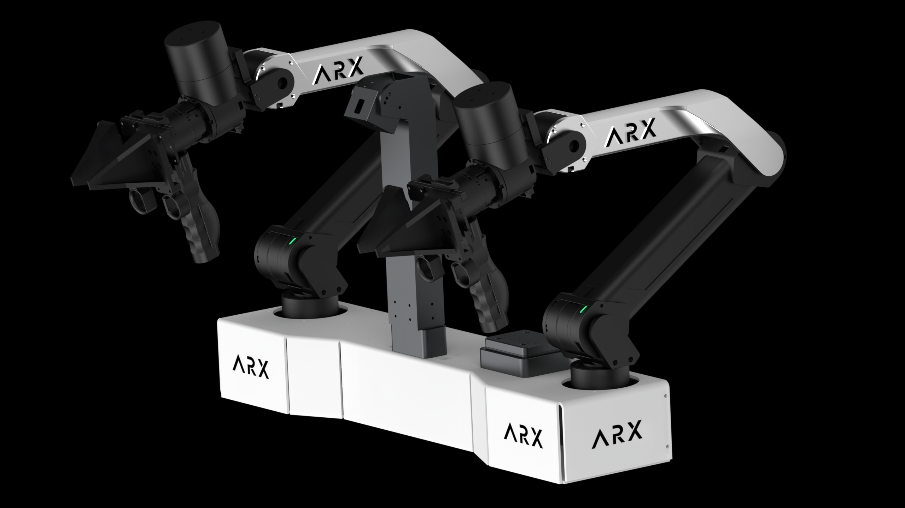
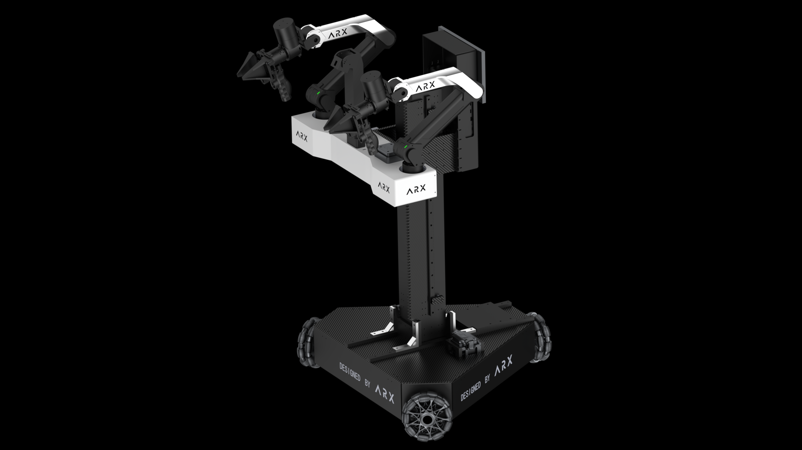
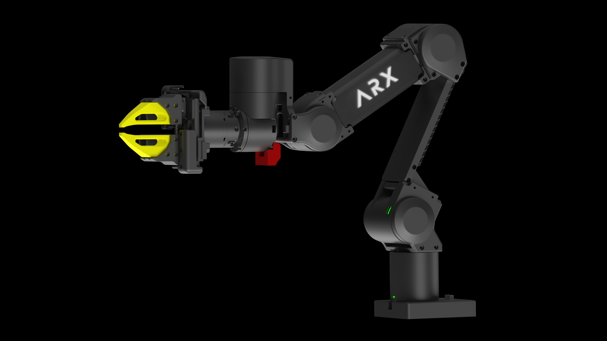
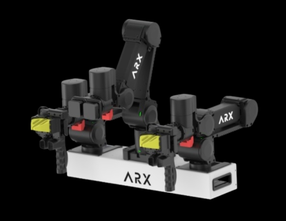

# ARX Robotics

## 🦾 Products

| Product | Repository | Preview |
| :------ | :--------- | :------ |
| **X5** | [beta_ARX5](https://github.com/ARXroboticsX/ARX5_beta) |   |
| **LIFT** | [LIFT](https://github.com/ARXroboticsX/LIFT) |  |
| **A5** | [A5 & A5-AC one](https://github.com/ARXroboticsX/A5_beta) |   |
| **LIFT-mini** | [LIFT-mini](https://github.com/ARXroboticsX/LIFT-mini-beta) |  |
| **CAD/URDF** | [model](https://github.com/ARXroboticsX/ARX_Model) | — |
